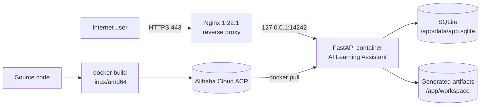
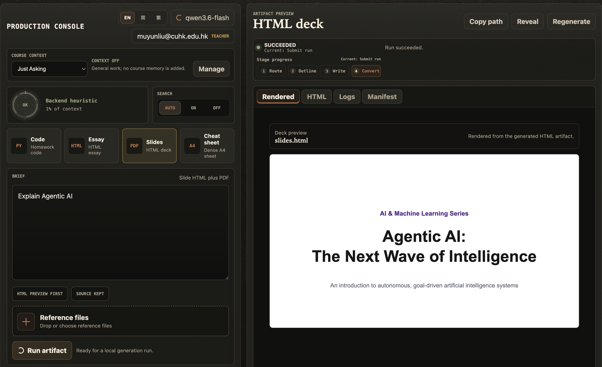

# AI Learning Assistant — Take-home Submission

**Course:** BA3073 Mobile and Cloud Computing (1001) · Dr. Zhiqiang LIAO · Semester 1, 2026-2027
**Assignment:** *From AI Agent to Cloud Service*
**Author:** Ziheng Lyu ([@zihenglyu](https://github.com/zihenglyu))

> The original assignment brief is preserved verbatim at [`docs/ASSIGNMENT.md`](docs/ASSIGNMENT.md).

---

## Submission at a glance

| # | Deliverable | Where |
| --- | --- | --- |
| 1 | Assignment report (≤ 20 pages, PDF) | [`submission/assignment-report.pdf`](submission/) · generated with the deployed app using [`submission/report-request.md`](submission/report-request.md) |
| 2 | Source-code repository | this repository |
| 3 | Local web-interface test | [`submission/evidence/local-ui-check.txt`](submission/evidence/local-ui-check.txt) |
| 4 | ECS web-interface test | [`submission/evidence/ecs-docker-check.txt`](submission/evidence/ecs-docker-check.txt) |

Supporting evidence: [`https-domain-check.txt`](submission/evidence/https-domain-check.txt) (access-control phase) and [`https-current-state.txt`](submission/evidence/https-current-state.txt) (current live state). Screening checklist: [`submission/README.md`](submission/README.md).

---

## Live deployment

| Surface | URL | Notes |
| --- | --- | --- |
| Public HTTPS (Task 3) | <https://takehomeassignment.michaellyu.fyi/ui/> | Nginx → `127.0.0.1:14242`, Let's Encrypt certificate |
| Health endpoint | <https://takehomeassignment.michaellyu.fyi/health> | returns `{"status":"ok"}` |
| ECS direct (Task 2) | <http://8.138.30.102:14242/ui/> | port 14242 restricted to the owner's IP in the security group |
| Local (Task 1) | <http://127.0.0.1:14242/ui/> | start with `bash scripts/run-local.sh` |

> The domain has no ICP filing, so Alibaba Cloud intercepts plain HTTP on port 80 and returns
> `403 Non-compliance ICP Filing`. HTTPS on 443 is unaffected — always use the `https://` URL.

---

## Architecture





---

## Results by task

### Task 1 — Local Docker deployment

- Image built from the supplied `Dockerfile` (Python 3.12 + Playwright/Chromium).
- Started with `docker compose -p ai-learning-assistant up --build -d`.
- `http://127.0.0.1:14242/health` → `{"status":"ok"}`; UI served at `/ui/`.
- Report-generation instructions were revised in
  [`backend/pipelines/essay_html.py`](backend/pipelines/essay_html.py) to require an
  academic report structure, evidence discipline, screenshot placeholders, print-ready
  CSS, and a hard 20-page limit.
- Automated check: [`local-ui-check.txt`](submission/evidence/local-ui-check.txt) → `HTTP 200`, `Result: PASS`.

### Task 2 — Aliyun ECS deployment through ACR

- Image built for `linux/amd64`, pushed to
  `crpi-otou15rf69k33qkj.cn-guangzhou.personal.cr.aliyuncs.com/michaellui/takehome:latest`.
- ECS (Debian 12) pulls the image and runs the container on port 14242.
- Observed container state: `Up (healthy)`, ports `0.0.0.0:14242->14242/tcp`.
- Automated check: [`ecs-docker-check.txt`](submission/evidence/ecs-docker-check.txt) → `HTTP 200`, `Website URL check: PASS`.

### Task 3 — Domain, HTTPS and reverse proxy

- DNS `A` record `takehomeassignment.michaellyu.fyi → 8.138.30.102`.
- Nginx site `/etc/nginx/sites-available/ai-agent` proxies to `http://127.0.0.1:14242`
  with `proxy_read_timeout 360s` and `proxy_buffering off` for long model responses.
- Certificate issued by Let's Encrypt for `takehomeassignment.michaellyu.fyi`,
  valid 2026-11-01 → 2027-01-30.
- An HTTP Basic Authentication layer was configured at the reverse proxy (separate from
  the application's BNBU login) and verified: `401` without credentials, `200` with them
  — see [`https-domain-check.txt`](submission/evidence/https-domain-check.txt). The site
  was later opened up; the security trade-off is documented in the report.

---

## Reproducing the deployment

```bash
# Task 1 — local build, run, and evidence
bash scripts/run-local.sh                 # stop with: bash scripts/run-local.sh --down

# Task 2 — build + push to ACR, deploy on ECS, collect evidence
cp scripts/deploy-ecs.env.example .env.ecs   # fill in ACR + ECS values (never committed)
bash scripts/deploy-ecs.sh all --env-file .env.ecs

# Task 3 — Nginx + Certbot + access control, collect evidence
bash scripts/setup-https.sh all --env-file .env.ecs
```

| Script | Purpose |
| --- | --- |
| `scripts/run-local.sh` | Local Compose build/start, health wait, `local-ui-check.txt` |
| `scripts/deploy-ecs.sh` | `all` / `build-push` / `server` / `check` for the ACR → ECS path |
| `scripts/setup-https.sh` | `all` / `server` for Nginx, Certbot and Basic Auth |
| `scripts/check-local-ui.sh` | Task 1 evidence recorder |
| `scripts/check-ecs-docker.sh` | Container/health assertions on the ECS |

---

## Deployment facts

| Item | Value |
| --- | --- |
| Local runtime | WSL2 / Ubuntu 26.04, Docker Engine 29.9.2 |
| ECS runtime | Debian GNU/Linux 12 (bookworm), Docker 29.2.1 |
| ECS public IPv4 | `8.138.30.102` |
| Container | `ai-learning-assistant-backend-1`, `0.0.0.0:14242->14242/tcp` |
| Reverse proxy | Nginx 1.22.1 |
| TLS | Let's Encrypt, `CN=takehomeassignment.michaellyu.fyi`, expires 2027-01-30 |
| Persistence | Docker volumes for `/app/data` (SQLite) and `/app/workspace` (artifacts) |

---

## Limitations and lessons learned

1. **Alibaba Cloud ACR rejects buildx attestation manifests**
   (`unknown manifest class for application/vnd.oci.empty.v1+json`); images must be built
   with `--provenance=false --sbom=false` so a plain single manifest is pushed.
2. **Certbot timed out on the ECS** because DNS returns both `A` and `AAAA` records while
   the instance has no working IPv6 route. Adding
   `precedence ::ffff:0:0/96  100` to `/etc/gai.conf` forces IPv4 and the certificate was
   issued immediately.
3. **No ICP filing for the domain**, so port 80 is intercepted upstream by Alibaba Cloud.
   HTTPS works, but the HTTP→HTTPS redirect and Let's Encrypt HTTP-01 renewals are
   affected; a domestic ICP filing or an overseas region would resolve it.
4. **Single-instance deployment**: SQLite and the artifact workspace are local volumes, so
   there is no horizontal scaling or high availability. Production would need a managed
   database, object storage, and a load balancer.

---

## Repository layout

```text
backend/     FastAPI API, SQLite storage, artifact pipelines, model providers
frontend/    Vite workbench renderer (production console + artifact preview)
apps/        Electron desktop shell
scripts/     Local run, ACR/ECS deploy, HTTPS setup, evidence collectors
submission/  Submission pack: checklist, report request, evidence, report PDF
docs/        Assignment brief, spec, architecture, rules, contracts, decisions
slides_html/ Reference slide-deck layout vocabulary
```

---

## Security notes

- No credentials, API keys, databases, or generated artifacts are committed.
  `.env*`, `data/`, `workspace/`, `.venv/`, and `node_modules/` are git-ignored.
- Personal model keys entered in the UI are encrypted and stored per account in SQLite;
  the server-side key lives only in the untracked `.env` on the ECS host.
- The security group exposes only TCP 80/443 publicly; port 14242 is restricted.
